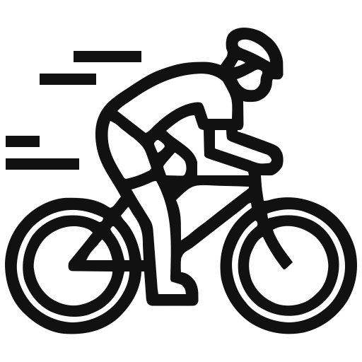

<div align="center">
  <p>
    
  </p>
  <h2>Create a personal cycling home page</h2>

  English | [简体中文](./README_zh.md)

  <p><a href="https://cyc.earth">https://cyc.earth</a></p>

  
  
  
  
  
  
</div>

## ✨ Features

- [x] 🌓 Dark and light themes
- [x] 🌐 English and 简体中文
- [x] 🌍 Mapbox globe of every ride
- [x] 📅 Year heatmap, activity list, and clustered tracks
- [x] 📊 Summary charts by year, month, week, and day
- [x] 🚴 Nightly import from iGPSPORT

## 🔨 Tech Stack

- ⚡ Framework - [Next.js](https://nextjs.org)
- 🧩 Language - [TypeScript](https://www.typescriptlang.org)
- 🌬️ Styling - [Tailwind CSS](https://tailwindcss.com)
- 🎛️ UI Library - [shadcn/ui](https://ui.shadcn.com)
- 🗺️ Maps - [Mapbox](https://mapbox.com)
- 🌐 Multi-language - [next-intl](https://next-intl.dev)
- 📈 Charts - [Recharts](https://recharts.org)
- 🧹 Formatter and linter - [Biome](https://biomejs.dev)
- 🪝 Git hooks - [Lefthook](https://lefthook.dev)
- 🧪 Tests - [Vitest](https://vitest.dev)
- 📊 Analytics - [Umami](https://umami.is)

## 🚀 Getting Started

### Vercel

[](https://vercel.com/new/clone?repository-url=https://github.com/sun0225SUN/cyc.earth)

> [!warning]
> Configure the required environment variables before running or deploying the project.

```bash
# Public site origin. Optional on Vercel.
NEXT_PUBLIC_SITE_URL=https://cyc.earth

# Mapbox. Required to draw the globe.
NEXT_PUBLIC_MAPBOX_TOKEN=

# Umami. Optional.
NEXT_PUBLIC_UMAMI_HOST=
NEXT_PUBLIC_UMAMI_WEBSITE_ID=
```

<details>
<summary><strong>Mapbox</strong></summary>

Create a public token at [Mapbox access tokens](https://account.mapbox.com/access-tokens/).

</details>

## 💻 Local development

1. Clone the repository

```bash
git clone https://github.com/sun0225SUN/cyc.earth.git
cd cyc.earth
```

2. Create `.env.local` in the repository root and set the variables from [Getting Started](#-getting-started).

3. Install dependencies

```bash
bun install
```

4. Start the development server

```bash
bun run dev
```

Open [http://localhost:3000](http://localhost:3000). English is the default locale. Chinese lives at `/zh`.

```bash
bun run build
bun run lint
bun run format
bun run test
```

## 🚴 Ride data

Activity files stay in `backend/`. The page reads `data/activities.json`.

```bash
cd backend
cp .env.example .env
# set IGPSPORT_PHONE and IGPSPORT_PASSWORD
# Strava rides also need STRAVA_CLIENT_ID, STRAVA_CLIENT_SECRET, STRAVA_REFRESH_TOKEN
make refresh igpsport
```

```bash
make -C backend check
make -C backend test
```

The `Refresh data` Action runs at midnight in Asia/Shanghai and commits the exported JSON when it changes. Set the `DATA_SOURCE` repository variable, the repository secrets, and the Strava keys as described in [docs/refresh-data.md](docs/refresh-data.md).

More detail: [`backend/README.md`](backend/README.md). Chinese: [`backend/README_zh.md`](backend/README_zh.md).

## 📁 Project structure

The UI follows [Feature-Sliced Design](https://feature-sliced.design) v2.1.

```text
app/                 Next.js routes
messages/            next-intl catalogs
data/activities.json Exported rides
backend/             iGPSPORT download, FIT parse, JSON export
src/_app/            providers, styles, i18n
src/_pages/          one slice per route
src/widgets/         large reusable blocks
src/features/        reusable user actions
src/entities/        business entities
src/shared/          UI kit and config
```

Agent notes live in [`AGENTS.md`](AGENTS.md) and [`docs/agent/`](docs/agent/).

## 👥 Contributors

<!-- readme: collaborators,contributors -start -->
<table>
	<tbody>
		<tr>
            <td align="center">
                <a href="https://github.com/sun0225SUN">
                    
                    <br />
                    <sub><b>Guoqi Sun</b></sub>
                </a>
            </td>
		</tr>
	<tbody>
</table>
<!-- readme: collaborators,contributors -end -->

## 📝 License

This project is licensed under the [GNU General Public License v3.0](LICENSE).

## 🤝 Contributing

Contributions are welcome. Open an issue or a pull request.

Commit titles follow `:emoji: type(scope): subject`, for example `:sparkles: feat(map): add activity heatmap`. Lefthook formats staged files, Commitlint checks the message, and `pre-push` runs the tests.

## ⭐ Star History

[](https://www.star-history.com/#sun0225SUN/cyc.earth&Date)
